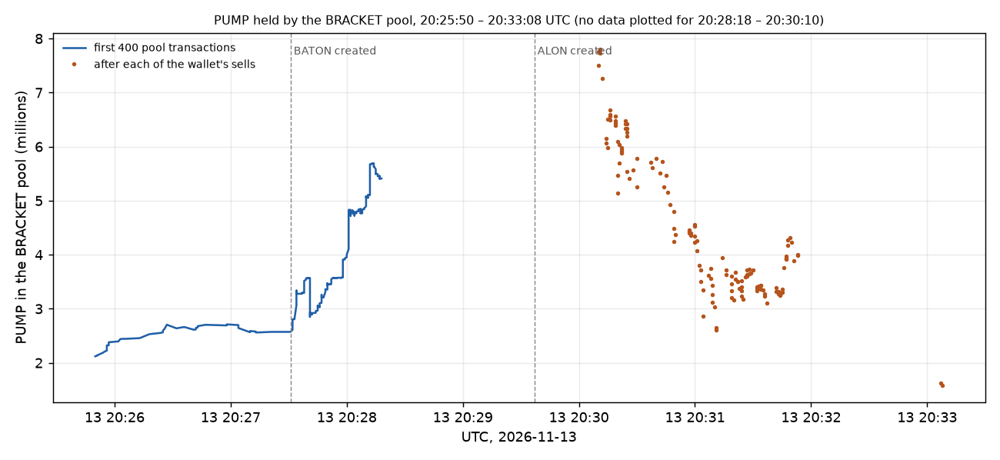

# ALON, BATON, BRACKET: on-chain record of a three-token pair chain

Token **ALON** ("Alon"), mint `8HQaU5pnmWgKijNsbcEDVQAvA6eNs577CRi8eqqqpump`, is quoted in the token **BATON** ("Baton Corporation"),
mint `5pwkNm6E69DyvyTvMna9rM5sTFogbBLH3N3rvymPpump`, which is quoted in the token **BRACKET** ("Bracket Company"), mint `D2mA5zAMARotHeuGRPRCa1rZzWKrBAD9v2nntBt8pump`,
which is quoted in the token **PUMP**, mint `pumpCmXqMfrsAkQ5r49WcJnRayYRqmXz6ae8H7H9Dfn`. The three tokens were created on 2026-11-13 by one
wallet, [`4BENHykj…`](https://solscan.io/account/4BENHykjCtFaakCjLjq6ngeMMyYz2Rjz3aBLXYgsiagi) (below: "the wallet").

This document states what the public Solana ledger records about the creation of the three tokens, the state
of their pools at each step, and the wallet's transactions. All times are UTC. Token amounts are in whole
tokens (all four tokens have 6 decimals). A wallet is an address, not a person.

## 1. Accounts

| Token | Mint | Bonding curve | Pool | Quoted in |
|---|---|---|---|---|
| BRACKET | [`D2mA5zAM…`](https://solscan.io/account/D2mA5zAMARotHeuGRPRCa1rZzWKrBAD9v2nntBt8pump) | [`BsGBJ5j9…`](https://solscan.io/account/BsGBJ5j9begxdHf8BRGfrSiMvocBFKAjmfQPdcmoEqa1) | [`4QMzTuBD…`](https://solscan.io/account/4QMzTuBDdQkc1C98AAUERhJtEwupAE7o3KdkPH8AXbcX) | PUMP |
| BATON | [`5pwkNm6E…`](https://solscan.io/account/5pwkNm6E69DyvyTvMna9rM5sTFogbBLH3N3rvymPpump) | [`8h2HXnM6…`](https://solscan.io/account/8h2HXnM6pBhNxuGvaRAijhJwxaRjHYh5x1ajUEV84ALf) | [`3fRSqbw1…`](https://solscan.io/account/3fRSqbw1sDs27dmRqjtHJt2Kswd1V3Lm72eMoqmnUk8q) | BRACKET |
| ALON | [`8HQaU5pn…`](https://solscan.io/account/8HQaU5pnmWgKijNsbcEDVQAvA6eNs577CRi8eqqqpump) | [`HimVK5XX…`](https://solscan.io/account/HimVK5XXgdxwUYAp2XEmQoGfQm7gNj7vomFS6WtNg2aN) | [`C4ndufD2…`](https://solscan.io/account/C4ndufD2V4anqgKD4JNpggTsLyURoAA5cEh4TNLq38sT) | BATON |

Full addresses are in `exhibits/accounts.csv`. The bonding-curve program is `6EF8rrecthR5Dkzon8Nwu78hRvfCKubJ14M5uBEwF6P`; the pool program is
`pAMMBay6oceH9fJKBRHGP5D4bD4sWpmSwMn52FMfXEA`.

## 2. How a token of this kind is priced

This section summarises the bonding-curve program's public documentation
(github.com/pump-fun/pump-public-docs) and the account data; it is included so the tables below can be read.

* A token is created with a supply of 1,000,000,000. 793,100,000 are sold through a bonding curve; the
  rest is placed in a pool when the curve is complete ("migration").
* A token may be quoted in another token created by the same program instead of in SOL. Its curve's
  starting virtual reserve is then set from the quote token's price at the moment of creation.
* A purchase that takes the last tokens of the curve continues, in the same transaction, at the price the
  pool will open at. The pool then opens holding only the tokens that purchase left.
* At migration a quantity of the quote token is set aside from the pool ("boost") and the same quantity is
  recorded in the pool account as a virtual quote reserve. The pool's price is
  (quote tokens held + virtual quote reserve) ÷ tokens held. The set-aside quantity is afterwards spent
  on purchases from the pool in transactions whose instruction is named `BoostBuyAndBurn`.
* Because ALON is priced in BATON, BATON in BRACKET and BRACKET in PUMP, the price of ALON in PUMP is the
  product of the three pool prices.

"Value of the full supply" below means price × supply. It is an arithmetic product, not an amount that
could be obtained by selling.

## 3. Sequence, 2026-11-13

SOL figures in this document that are not ledger balance changes use the rate of the wallet's own PUMP
acquisition (132.5550 SOL for 3,003,105.85 PUMP = 4.4139e-05 SOL per PUMP) and are
marked "≈".

| Time | Transaction | What the ledger records |
|---|---|---|
| 19:51:12 | [2uWXtQmE…](https://solscan.io/tx/2uWXtQmEm5c1XZwpw7KpkZUKwSPP6ECujcaeMjFiA5QKMgkpGaTwTGpRsXGXVLti7SzKkr4EUJYnx4EisZQRCJAA) | The wallet's SOL balance falls by 132.5550 and its PUMP balance rises by 3,003,105.85 (instruction `Fill`, program `61DFfeTK…`; the wallet is a co-signer). |
| 20:25:49 | [3uFXpAKa…](https://solscan.io/tx/3uFXpAKa36ZLytLG6UZi2jH9QvrKabzGhnVdTrX4hjDwSWT4P7DuurhRZ2uugZ8m9nCF2E31p5iHPkDHo6hH3US2) | BRACKET is created and bought in one transaction. The wallet pays 2,706,909.41 PUMP (≈119.5 SOL) and receives 793,100,000 BRACKET, the whole curve allocation. |
| 20:25:50 | [2YrTdh9B…](https://solscan.io/tx/2YrTdh9BfpAy2byKdx4pGyNzMAcofpVqA1dJ1KcptrJ9Q2pEcDzfpX3wwk18eiqD8dvwtExHsawGbKt237Z8pvrk) | BRACKET is migrated (2 slots later; fee payer [`9C4nRvhh…`](https://solscan.io/account/9C4nRvhhVquCKATjDCx5FKvNS9PNgNqgyWy9AcoDjYv5)). Pool receives 206,900,000 BRACKET and 2,120,345.53 PUMP; 553,145.24 PUMP is set aside. |
| 20:27:31 | [q12aiQsj…](https://solscan.io/tx/q12aiQsjr5GzUnwAipJwDzwXcet594CK25w5uui7NKHupnk5MLGpB3EGVsDaT5eeCQxhYE41awPdCZUmEezTZxB) | BATON is created, quoted in BRACKET. Starting virtual reserve 28,851,822.04 BRACKET. |
| 20:27:31 | [4btnhMHt…](https://solscan.io/tx/4btnhMHtyhqzYW4asxtcF8NPRp4Yc5A2HeB4uLSBY7dvpFU38omPRx1k1p1XMFPr3bVqzfnP99kwmbC6ca1w8F97) | Same slot. The wallet pays 789,000,000 BRACKET and receives 978,294,149.09 BATON (97.83 % of supply), of which 185,194,149.09 beyond the curve allocation. |
| 20:27:31 | [4Lef1kYn…](https://solscan.io/tx/4Lef1kYnwznBt7Jv1qSuyHWKkJ33TYvzGhhPXzFun6L54KYrFDZKTeMpgvZS8s11VMfZpNfeAPipTK3MARpBNnJM) | BATON is migrated (1 slot later; same fee payer). Pool receives 21,705,850.91 BATON and 762,344,773.96 BRACKET; 16,914,485.30 BRACKET is set aside. |
| 20:29:37 | [3QXZtFDd…](https://solscan.io/tx/3QXZtFDdmSnuGnztdRfXXJgXm5EdzTmryzwqX2Q9psTtDw7LtDo3x63NL95MsPB6skqxeHRYJfNPJ1J3WmErEog2) | ALON is created, quoted in BATON. Starting virtual reserve 232,439.80 BATON. |
| 20:29:37 | [2JC7WWwr…](https://solscan.io/tx/2JC7WWwr8mpMDikyrE4fq5v64ZmLjPXfLMyrTsbKR9MMDZVjJYoBp1zFp4as2BcVaigtZzo4ANAv2B4U1cYSKAUk) | Same slot. The wallet pays 270,000,000 BATON and receives 999,488,992.48 ALON (99.9489 % of supply), of which 206,388,992.48 beyond the curve allocation. |
| 20:29:37 | [2zEEdLRJ…](https://solscan.io/tx/2zEEdLRJ71H8Yfrfq3Z64qa3tDiJ8N7UasJNbNoBv3R9u9s5ydHgnrKDuucutB6GQUq895fanvc3ox9grKx6mR5j) | ALON is migrated (1 slot later; same fee payer). Pool receives 511,007.52 ALON and 266,530,397.99 BATON; 136,268.67 BATON is set aside. |
| 20:30:05 | [8sZSaHDh…](https://solscan.io/tx/8sZSaHDh4mp7nWGyhH7vuQn8eEVPPXTMTN7Wqv4MhjakbLC2niP6R5tc5hspRY6KW16vXot6GeEiJXXFPbn2Ua5) | The wallet transfers 999,000,000 ALON to [`6DtEedWf…`](https://solscan.io/account/6DtEedWf9Wk5hA7Xth82Eq441yf5DA4aGLqaQAVfDokm). |
| 20:30:10 | [5q3Av4oY…](https://solscan.io/tx/5q3Av4oYuC1yFYuTpZnvAMJ7Q2j5uuiHsmeLmPFRheBrP13YUHi8iUkanTjPP44jiCU1mj5SzCkpThDwqY5Fb78m) | The wallet's first sale of ALON (section 5). |

After the three purchases the wallet held 4,100,000 BRACKET,
708,294,149.09 BATON and 999,488,992.48 ALON.
Every balance change in the creation, purchase and migration transactions is in `exhibits/curve_transactions.csv`.

### Pool contents at migration

| Pool | Tokens | Quote tokens held | Virtual quote reserve | Price |
|---|---|---|---|---|
| BRACKET | 206,900,000.00 BRACKET | 2,120,345.53 PUMP | 553,145.24 PUMP | 0.0129217 PUMP per BRACKET |
| BATON | 21,705,850.91 BATON | 762,344,773.96 BRACKET | 16,914,485.30 BRACKET | 35.9009 BRACKET per BATON |
| ALON | 511,007.52 ALON | 266,530,397.99 BATON | 136,268.67 BATON | 521.845 BATON per ALON |

At its migration the value of BRACKET's full supply was 12,921,657 PUMP (≈570 SOL).

## 4. Transactions on the BRACKET pool by other accounts

The BRACKET pool is the only one of the three whose quote token (PUMP) is not one of the three tokens.

* The first 400 successful transactions on the pool are the migration and the 399 that follow it, from
  20:25:51 to 20:28:18. One of the 399 is the wallet's creation of BATON, which reads the pool and
  does not change its balances; the other 398 have 192 distinct fee payers.
  The first is 5 slots after the migration.
* 12 of the 400 carry the instruction `BoostBuyAndBurn`; their fee payer is [`HTVZVEQM…`](https://solscan.io/account/HTVZVEQMBsNanubDPTs3CxDAEGNFQHJY8c1441iy2S5r).
* In those 400 transactions 5,574,677 PUMP entered the pool and 2,283,621 PUMP left it. The pool's PUMP
  balance went from 2,120,346 at migration to 5,411,401 at 20:28:18, and its
  BRACKET balance from 206,900,000 to 93,245,983.
* Immediately before the wallet's first sale (20:30:10) the pool held 7,612,851 PUMP and
  69,078,928 BRACKET. Before that moment the wallet's transaction list contains no transaction
  that changes this pool's balances, so the increase of 5,492,505 PUMP since migration (≈242 SOL) came from
  transactions of other accounts.

State of the three pools immediately before the wallet's first sale:

| Pool | Tokens | Quote tokens held | Price | Value of the full supply |
|---|---|---|---|---|
| BRACKET | 69,078,928 BRACKET | 7,612,851 PUMP | 0.118213 PUMP | 118,212,546 PUMP (≈5,218 SOL) |
| BATON | 20,927,832 BATON | 791,909,055 BRACKET | 38.6482 BRACKET | 4,568,704,980 PUMP (≈201,660 SOL) |
| ALON | 510,385 ALON | 266,858,746 BATON | 523.125 BATON | 2,390,002,038,856 PUMP (≈105,493,057 SOL) |

Between migration and that moment the price of BRACKET in PUMP rose by a factor of 9.15. The ALON pool's
own contents changed by -622 ALON over the same interval.

The pools' later histories are large: more than 201,000 signatures were listed for each pool for the period
up to about 20:50, and listing was not continued further back. The record therefore covers the BRACKET pool's
first 400 transactions in full and, after that, the pool states recorded in the wallet's own transactions.

## 5. The wallet's sales

| Sold | Transactions | Period | Tokens sold | Share of supply | SOL received |
|---|---|---|---|---|---|
| ALON | 136 | 11-13 20:30:10 – 11-13 20:33:08 | 50,660.70 | 0.0051 % | 1,020.7879 |
| PUMP | 4 | 11-15 00:09:37 – 11-15 00:12:15 | 1,084,713.70 |  | 43.7974 |
| BRACKET | 2 | 11-15 00:10:28 – 11-15 00:10:28 | 43,924,013.58 | 4.3924 % | 2.3728 |
| BATON | 2 | 11-15 00:10:50 – 11-15 00:10:50 | 51,682,997.56 | 5.1683 % | 0.8838 |
| Total | 144 | | | | 1,067.8420 |

* Each ALON sale is one transaction that sells ALON for BATON in the ALON pool, BATON for BRACKET in the
  BATON pool, BRACKET for PUMP in the BRACKET pool, and PUMP for SOL (instructions `MultiHopSwap`, `SellV2`).
  The amounts range from 39.14 to 1,718.02 ALON; the largest by SOL is
  [DgxDREAb…](https://solscan.io/tx/DgxDREAb6C4ahUdo7y7FLnygVEaVAM8kwh5oLD6xhLrwfecgjfiSnwXcgA4JWyDBEW5oxAhUW6JbQaawuELKF53) (484.85 ALON, 28.4013 SOL).
* Across the 136 ALON sales the BRACKET pool paid out 23,848,295 PUMP. Over the same period
  (20:30:10 – 20:33:08) the pool's PUMP balance went from 7,612,851 to 1,586,356, a
  fall of 6,026,495. The difference, 17,821,800 PUMP (≈787 SOL), is the net
  amount of PUMP that other transactions added to the pool in that period.
* The state of all three pools after each sale is in `exhibits/pool_states_at_wallet_sells.csv`.

## 6. The wallet's other transactions

The wallet has 220 successful transactions between 2026-11-12 08:04:14 and 2026-11-15 01:43:05
(`exhibits/wallet_transactions.csv`).

* **Creator fees collected** (instructions `CollectCreatorFeeV2`, `CollectCoinCreatorFee`): 788,517.26 PUMP,
  39,824,013.58 BRACKET, 78,746,891.84 BATON.
* **Token transfers out**: 999,000,000 ALON to [`6DtEedWf…`](https://solscan.io/account/6DtEedWf9Wk5hA7Xth82Eq441yf5DA4aGLqaQAVfDokm) at 20:30:05;
  438,331.77 ALON in 9 transfers to 9 accounts at 20:30:53;
  735,358,043.37 BATON in 32 transfers to 9 accounts between 20:35:56 and 20:53:45;
  the BATON recipients are the same accounts as the ALON recipients.
* **SOL transfers**: 470.8517 SOL received in 2 transfers and 1,405.0406 SOL
  sent in 8 transfers.
* Each transfer and its counterparty account is in `exhibits/wallet_transfers.csv`. The accounts that received
  tokens or SOL were not examined further.

SOL paid for PUMP: 132.5550. SOL received from the sales in section 5: 1,067.8420.
At the end of the period the wallet held no PUMP, BRACKET, BATON or ALON.

## 7. State at slot 469856591 (2026-11-15 20:03:26)

| Pool | Tokens | Quote tokens held | Virtual quote reserve | Price | Supply | Value of the full supply |
|---|---|---|---|---|---|---|
| BRACKET | 760,300,838.60 BRACKET | 313,978.01 PUMP | 553,145.24 PUMP | 0.0011405 PUMP | 983,282,026.94 | 1,121,433 PUMP (≈49 SOL) |
| BATON | 201,220,222.05 BATON | 86,405,151.41 BRACKET | 16,914,485.30 BRACKET | 0.513465 BRACKET | 998,945,587.06 | 584,990 PUMP (≈26 SOL) |
| ALON | 343,482.22 ALON | 437,199,688.69 BATON | 136,268.67 BATON | 1273.24 BATON | 999,999,661.10 | 745,619,734 PUMP (≈32,911 SOL) |

The SOL figures in this table use the PUMP rate of 2026-11-13 stated in section 3, not the rate at the slot.

Largest ALON token accounts, read shortly after that slot (all three tokens: `exhibits/largest_token_accounts.csv`):

| Owner | ALON | Share of supply |
|---|---|---|
| [`6DtEedWf…`](https://solscan.io/account/6DtEedWf9Wk5hA7Xth82Eq441yf5DA4aGLqaQAVfDokm) | 999,000,000.00 | 99.9000 % |
| [`C4ndufD2…`](https://solscan.io/account/C4ndufD2V4anqgKD4JNpggTsLyURoAA5cEh4TNLq38sT) (pool ALON) | 343,482.22 | 0.0343 % |
| [`GgbCFRHH…`](https://solscan.io/account/GgbCFRHHAPv5i1fqt1D1buf8FPNA31oKrkZvXDyZymsT) | 94,588.72 | 0.0095 % |
| [`HLnpSz9h…`](https://solscan.io/account/HLnpSz9h2S4hiLQ43rnSD9XkcUThA7B8hQMKmDaiTLcC) | 84,463.58 | 0.0084 % |
| [`F8qsJofR…`](https://solscan.io/account/F8qsJofRMpj5LhbPiZzp41be7RjP4bxLZr1PB7UFdHAU) | 45,690.16 | 0.0046 % |
| [`8YfLjM88…`](https://solscan.io/account/8YfLjM88zj4kPQgTrQoJTPFcQt2kRqsJzNK5UvCmndqi) | 41,396.85 | 0.0041 % |

## 8. Method and limits

1. The token, curve and pool accounts were read from a Solana RPC node and decoded with the layouts in the
   programs' public interface definitions. The quote chain was followed from ALON's curve account down to PUMP.
2. All signatures of the three curve accounts and of the wallet were listed, and every successful transaction
   was fetched in parsed form (15 curve transactions, 220 wallet transactions).
3. For the BRACKET pool the first 1,000 successful signatures were listed in ascending order and the first
   400 transactions fetched.
4. Every amount is the difference between the validator-recorded pre- and post-balances of the account
   concerned (token balances by owner and mint; SOL balances by account). Instruction names are the names the
   programs write to the transaction log.
5. Pool prices are computed as (quote tokens held + the pool account's virtual quote reserve) ÷ tokens held.
   The virtual quote reserve is a field of the pool account and is not part of a transaction's recorded
   balances. For sections 3 to 5 it is taken as the quantity set aside at the pool's migration, which is the
   value the field held when first read on 2026-11-15 at about 19:20. At slot 469856591 the field read
   553,145.24 PUMP (BRACKET), 16,914,485.30 BRACKET (BATON), 136,268.67 BATON (ALON), a difference of at most
   0.00 % from the migration quantities; section 7 uses the values read at that slot.
   A difference of that size changes the prices computed in sections 3 to 5 by less than 0.02 %.
6. Key transactions were re-read from a second node (`verification.md`).

Limits:

* The pools' complete transaction histories were not retrieved; see section 4.
* The accounts that traded on the pools, and the accounts that received transfers from the wallet, were not
  examined. The record says nothing about who controls any account.
* SOL figures marked "≈" convert PUMP at a single rate, the one in the wallet's own acquisition. No US-dollar
  figures are given.
* The record ends at slot 469856591.
